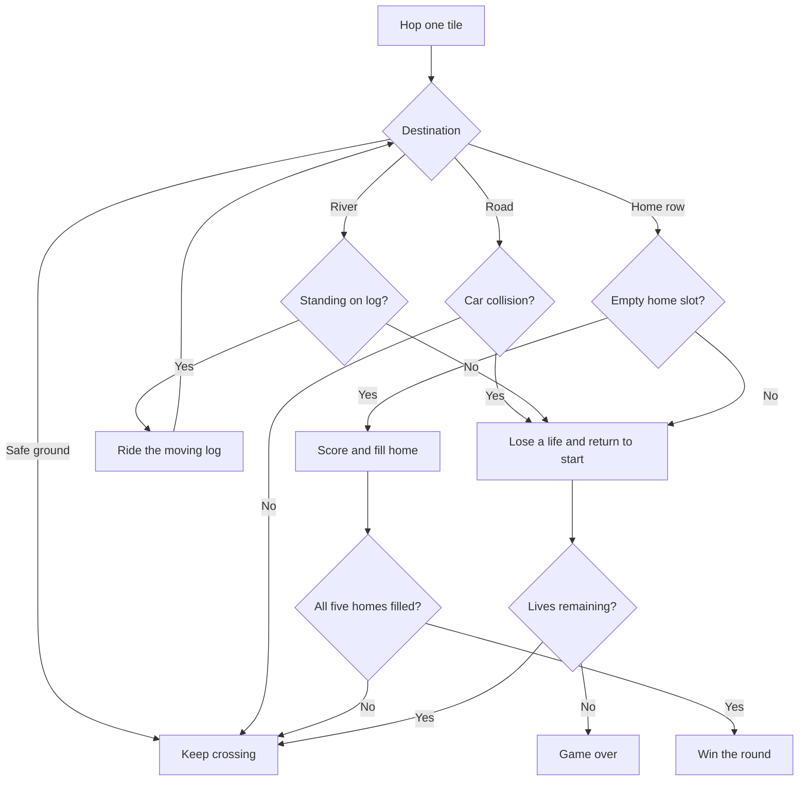

# Hop Home

A tiny after-dark crossing game built with Vue 3, TypeScript, and SVG. Dodge the traffic, ride the river logs, and tuck into all five safe spots before your three leaps run out.

**Play:** [oscarmmi.github.io/frogger](https://oscarmmi.github.io/frogger/)

## How to play

- Hop one tile with the **arrow keys** or **WASD**. On a phone, use the on-screen D-pad.
- Cross the road without touching a car. On the river, stay aboard a moving log.
- Reach an unoccupied home slot at the top to score and start another crossing.
- Fill all five home slots to win. You have three lives; the best score is saved in this browser.
- Press **Esc** to pause or resume and **R** to start a new run.

## Run locally

```sh
npm install
npm run dev
```

Run the game-logic tests and production build:

```sh
npm test
npm run build
```

## Game loop



## Built with

- Vue 3 + TypeScript + Vite
- SVG original artwork and a self-contained, pure TypeScript game model
- Vitest for gameplay rules
- GitHub Pages deployment on every push to `main`
